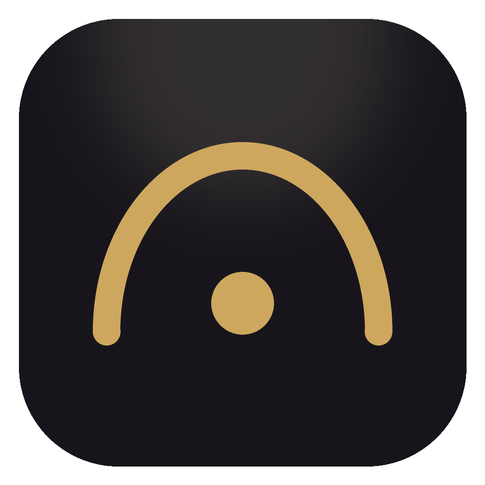

<p align="center"></p>

<h1 align="center">Fermatta</h1>

<p align="center">Записывайте игру на цифровом пианино и слушайте её концертным роялем.<br>
Падающие ноты, видео для TikTok и YouTube, редактор нот и ноты в PDF.</p>

<p align="center"><b>Windows · бесплатно · без интернета после установки</b> · <a href="#english">English</a></p>

---

## Что умеет

**Запись**
- Подключите пианино кабелем USB (проверено на Yamaha P-45) и нажмите «Записать» или пробел.
- Пока играете, слышите своё пианино, а потом слушаете запись дорогим роялем.
- Пауза, корзина с возвратом, копии, переименование. Горячие клавиши можно переназначить.
- Запись можно начинать двойным нажатием педали.
- **Дозапись с любого места:** приложение проигрывает несколько секунд перед меткой, вы продолжаете играть. Старое после метки можно заменить или оставить и наложить новое поверх.

**Звук**
- Каталог бесплатных концертных роялей, скачиваются в один клик: Yamaha C5, Yamaha CF-3, Steinway, Yamaha C3, Osiris. Можно добавить свой рояль в формате SFZ.
- Длина звучания: короче или вплоть до бесконечной педали.
- Шесть залов: от комнаты до собора, с настройкой размера, задержки отражений и окраски.
- Эффекты: объём (ширина стерео), компрессор, эхо.
- Яркость звука, сила игры, отдельная громкость левой и правой руки, тональность, темп.
- Резонанс струн при нажатой педали и шумы механики, если они есть у рояля.

**Падающие ноты и видео**
- Свои цвета для каждой руки и для клавиш.
- Фон: градиент, цвет, картинка или видео.
- **Видеостудия:** готовые стили («Огонь и лёд», «Неон», «Сияние», «Золото», «Сакура», «Классика») и вкладки Фон, Ноты, Клавиши, Эффекты, Камера, Звук.
- Ноты-капсулы со светящейся серединкой, неон и ещё четыре формы; ноты могут менять цвет у клавиатуры.
- Огненная или лазерная линия над клавишами, вспышки, угольки, искры, пыль, облака дыма, свечение клавиш.
- 3D-наклон, сколько секунд нот видно вперёд, высоту клавиатуры можно тянуть мышкой прямо на превью.
- Видео в форматах 9:16, 16:9 и 1:1, до 4K и 60 кадров в секунду, кодируется видеокартой.

**Ноты**
- Редактор как в FL Studio: карандаш, ластик, выделение, растягивание, сила нажатия, дорожка педали, отмена действий.
- Темп определяется сам по вашей игре. Кнопка «Выровнять» подтягивает ноты к сетке с нужной силой, ровность темпа тоже регулируется.
- Руки распределяются автоматически, исправить можно вручную.
- **Сравнение с нотами:** находит фальшивые, пропущенные и лишние ноты и исправляет их, сохраняя ваш темп и силу нажатия.
- Нотный стан прямо в приложении. Экспорт в PDF, MusicXML (MuseScore) и MIDI.

**Открыть что угодно**
- MIDI и MusicXML.
- **MP3 или видео с игрой на пианино:** нейросеть снимает ноты по слуху, точность около 99% на чистой записи.
- **PDF, скан или фото нот:** распознаются в ноты.

## Установка

Скачайте установщик на странице [Releases](../../releases) и запустите.

При первом запуске приложение предложит скачать рояль (~0,8 ГБ). Модули распознавания звука (150 МБ) и нот с листа (81 МБ) скачиваются сами, когда впервые понадобятся.

## Сборка из исходников

```bash
npm install
npm start
```

Установщик: `npm run dist` (появится в `dist/`).

## Как это устроено

- Electron. Звуковой движок написан на AudioWorklet и читает сэмплы из общей памяти, поэтому живое воспроизведение и экспорт звучат одинаково.
- Сэмплы роялей переводятся в «пакет» (16-бит, 48 кГц) с помощью ffmpeg, разбор SFZ свой.
- Падающие ноты рисуются одной и той же функцией в предпросмотре и в видео. Кодирование через WebCodecs (H.264), сборка через ffmpeg.
- Ноты по звуку: модель Kong et al. (ByteDance) через ONNX Runtime.
- Ноты с листа: [Audiveris](https://github.com/Audiveris/audiveris).
- Нотный стан: [OpenSheetMusicDisplay](https://opensheetmusicdisplay.org).

Список сторонних компонентов и их лицензий: [THIRD_PARTY.md](THIRD_PARTY.md).

---

## English

Fermatta records your digital piano over USB and plays it back on free concert-grand sample libraries. It also gives you:
- punch-in recording from any point (replace or overlay);
- a video studio with presets, glowing capsule notes, fire/laser hit lines, embers, smoke, 3D tilt;
- reverb, stereo width, compressor and echo;
- falling-notes videos (9:16, 16:9 and 1:1, up to 4K60);
- an FL Studio-style piano roll with tempo detection and timing alignment;
- comparison with a score that finds and fixes wrong notes;
- MusicXML, MIDI and PDF export;
- audio and video to notes (AI transcription);
- PDF and photo to notes (Audiveris).

Windows only. Interface in English and Russian.

License: MIT for the app's code. Third-party pieces keep their own licenses, see [THIRD_PARTY.md](THIRD_PARTY.md).
